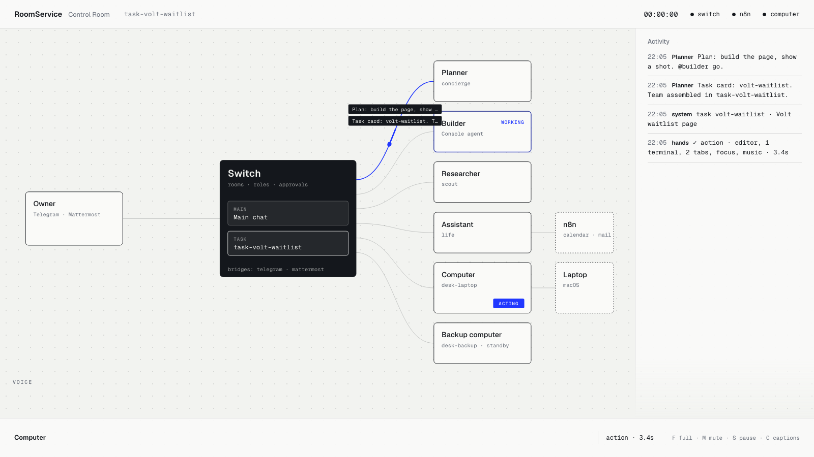

# RoomService

[](https://github.com/InnoShay/switchers/actions/workflows/ci.yml)
[](LICENSE)

**Say one sentence from your phone. Your computer wakes up, a team of AI agents takes the job in a Switch room, and nothing risky happens without your approval code.**

RoomService gives a Switch room a body. A small program (the **Computer**) joins your Switch rooms as an agent and acts on your real machine: it opens your project, starts the dev server, takes screenshots, commits after you approve, and hands its job to a second machine if the first one dies. Everything it does is a message in a Switch room, so everything is visible, replayable and approvable from Telegram or Mattermost.



*The Control Room (`http://127.0.0.1:7777`): every message and action lights the path it travelled through Switch.*

## What it does

| You say (phone or desk) | What happens |
|---|---|
| "Room service, tonight we ship the Volt waitlist page" | The desk wakes (HUD, voice), opens the project, starts the dev server. The **Planner** creates a task room and a plan. |
| "show me" | The Computer screenshots the running page into the chat. |
| "make the join button orange and bigger" | The **Builder** edits the code; a new screenshot follows. |
| `@computer commit "waitlist v1"` | The chat shows `⚠️ approval needed … ok K7Q3`. Nothing runs until you reply `ok K7Q3`. |
| `@computer projects`, "open Splitzy" | Finds any project under your projects folder and starts it, with no config file to edit. |
| `@computer exec "npm test"` | Any other command, but only after you approve the exact text with a code. |
| Close the laptop | The backup computer takes the **hands** role within about 15 seconds. |
| "wrap up", then tomorrow "resume Volt" | A diary and boot state are saved in the room and restored. |

## How Switch is used

Without Switch there is no phone-to-desk link, no task rooms, no handoff and no approvals.

| Switch primitive | Used for |
|---|---|
| Rooms bridged to Telegram and Mattermost | the main chat on the phone, task rooms on the desk |
| Agent protocol (WebSocket and HTTP) | our own agents `desk-laptop`, `desk-backup`, `life` |
| Agent-run templates (`run_template`) | every task room is created the same way, by the Planner |
| Room instructions and documents | briefing, task brief, diary, boot state |
| Roles and leases | the `hands` role moves between machines |
| Aliases and addressing rules | `@computer` works in every room; the desk obeys only the owner |
| Room links, media upload, typing indicator, room commands | signposts, screenshots, "computer is typing", `!assign-agent` |


## Quick start

Needs macOS (Linux and Windows notes in the guide), Docker Desktop, [uv](https://docs.astral.sh/uv/), Node 20+, [Switch Console](https://switchagents.ai) 0.40 or newer, and an agent provider signed in.

```bash
git clone https://github.com/InnoShay/switchers.git
cd switchers
bash scripts/bootstrap.sh        # dependencies, demo project, local Switch server, templates, health check
```

Then follow [docs/SETUP.md](docs/SETUP.md) (about 10 minutes of clicking: registration key, Console, two templates, pairing). Start everything with:

```bash
bash scripts/demo_up.sh          # Docker, Switch, doctor, the desk and the Control Room
```

**Just want to see the Control Room?** No Switch, keys or Docker needed:

```bash
uv sync
uv run roomservice hud --demo    # http://127.0.0.1:7777, a scripted story of every event
```

`uv run roomservice doctor` checks the whole setup and prints a fix next to every red line. [docs/try-it.md](docs/try-it.md) lists ten things to say once it runs.

## The team

Plain names in chat and in the HUD. Switch cannot rename an agent after it is created, so the Switch name stays underneath; rooms accept both.

| Name | Type | Switch agent | Does |
|---|---|---|---|
| Planner | `@planner` | `concierge` | turns a sentence into a task room, a team and a plan |
| Builder | `@builder` | `builder` | writes the code |
| Researcher | `@researcher` | `scout` | finds references |
| Computer | `@computer` (`@hands` works too) | `desk-laptop`, role `hands` | acts on your Mac |
| Backup computer | `@backup` | `desk-backup` | takes over when the Computer disappears |
| Assistant | `@assistant` | `life` | calendar and email through n8n (optional) |

A **task** is one job with its own task room (`task-<slug>`). The **main chat** is the room you talk in. **Wake-up** is the first sentence ("room service" or "hey computer"). **Pause** stops the Computer. **Wrap up** ends the day.

## Safety

- The Computer obeys only the paired owner (pairing code, one per surface) and the owner's own agents. Other people and other agents are refused.
- A fixed grammar and allowlist: only apps, URLs and scripts you list in `config/desk.yaml`. `@computer open Steam` is refused.
- Risky steps (`commit`, `push`, `close all`, scripts marked `confirm`, and every free-form `exec`) wait for a one-time approval code, valid for five minutes, answerable only by the owner.
- Automatic limits: 20 actions per minute, at most 5 commands per message, a mirror rate limit that stops message loops, and a pause key (`S` in the Control Room) that stops everything.
- The Computer never runs a shell except for an approved `exec`. Secrets live in `.env` and `~/.roomservice` (mode 600) and are redacted from logs.

See [docs/power.md](docs/power.md) for what you can say and why it is safe.

## Commands

```bash
uv run roomservice up          # start the Computer, the Control Room, the Assistant and the scheduler
uv run roomservice backup      # start the Backup computer (see docs/SETUP.md)
uv run roomservice pair        # print a pairing code for a new chat surface
uv run roomservice register    # register desk-laptop and life with Switch
uv run roomservice doctor      # check the whole setup
uv run roomservice hud --demo  # Control Room only, scripted events
uv run roomservice build-templates   # rebuild switch/templates/dist/*.yaml
```

## Repository

```
roomservice/        Python package: desk (grammar, allowlist, approvals, OS adapters), agents, relay, HUD
  hud/static/       the Control Room (plain HTML, CSS and ES modules, no build step)
switch/             agent instructions and the two Switch templates (dist/ is generated and committed)
demo/volt/          the seed project the demo builds on
config/             desk.example.yaml (copy to desk.yaml; setup does it for you)
scripts/            bootstrap, Switch server setup, demo start, per-OS setup
n8n/, infra/        optional calendar and email workflow
docs/               setup guide, power guide, architecture, blog draft
tests/              unit, contract (fake Switch) and live tests
SPEC.md, DECISIONS.md   the build specification and every decision taken against it
```

## Development

```bash
uv sync
uv run ruff check .
uv run pytest -m "not live"      # no network, no Switch: contract tests use a fake Switch server
```

CI runs the same two commands on every pull request. Live tests (`-m live`) need a real Switch server and a filled `.env`.

## Team

Built for the Flip the Switch hackathon by Yash Goel and Lakshay Sharma. #HowISwitch

MIT licensed, see [LICENSE](LICENSE).
