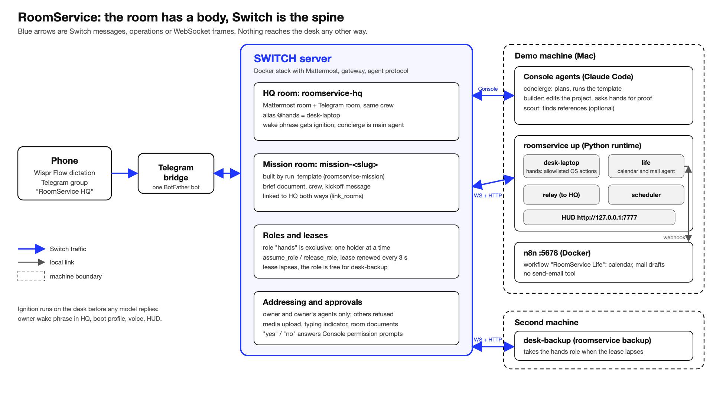

# RoomService

[](https://github.com/InnoShay/switchers/actions/workflows/ci.yml)

**RoomService turns your physical room into a Switch room: one spoken sentence boots your desk, spawns a task room with a team of agents, and keeps you in control from your phone, with a computer that acts only through Switch.**


<!-- HUMAN TODO (Yash): record the 10 s wake-up clip and save it as docs/ignition.gif (max 8 MB). Until then this image is broken. -->

## Watch the demo

[Watch the 2:45 demo video](VIDEO_URL_PLACEHOLDER)

<!-- HUMAN TODO (Lakshay, RS-16): replace VIDEO_URL_PLACEHOLDER with the unlisted YouTube link. -->

Built for the Flip the Switch hackathon. Hashtag: #HowISwitch.

## Names

Plain names in chat and in the HUD. Switch cannot rename agents, so the Switch agent name stays underneath (set the display names in Switch Console). Rooms accept the plain alias and the Switch name.

| Plain name | Type | Switch agent name |
|---|---|---|
| Planner | `@planner` | `concierge` |
| Builder | `@builder` | `builder` |
| Researcher | `@researcher` | `scout` |
| Computer (acts on the Mac) | `@computer` (`@hands` still works) | `desk-laptop` (role `hands`) |
| Backup computer | `@backup` | `desk-backup` |
| Assistant (calendar, email) | `@assistant` | `life` |

Words: a **task** is one job with its own **task room** (`task-<slug>`), the **main chat** is the room you talk in, **wake-up** is the first sentence that boots the desk ("room service" or "hey computer"), **pause** stops the Computer, **wrap up** ends the day, the **team** is the agents above.

## What breaks without Switch

Every piece of RoomService is a Switch primitive doing a job. Take Switch away and the room has no body, no memory and no leash.

| Switch primitive | Used for |
|---|---|
| Rooms bridged to Telegram + Mattermost | main chat on the phone, tasks on the desk |
| Agent protocol (WebSocket + HTTP) | Our own Computer (`desk-laptop`), Backup computer (`desk-backup`) and Assistant (`life`) agents |
| Agent-run templates (`run_template`) | Task rooms spawned the same way every time |
| Room instructions | Every agent briefed once |
| Room documents | Task brief, day diary, boot state |
| Roles + leases | The `hands` role moving between the Computer and the Backup computer |
| Room links | The main chat and task rooms point at each other |
| Aliases | `@computer`, `@planner` and the other plain names work in every room |
| Addressing rules | The desk obeys only the owner and the owner's agents |
| In-room approvals ("yes") | The builder's risky steps |
| Media upload | Screenshots from the desk into rooms |
| Typing indicator | "Computer is typing" while an action runs |
| Room commands | `!invite-agent`, `!assign-agent`, `!set-alias`, `!roles` |

## Architecture



A message from your phone travels through the Telegram bridge into the Switch main chat. The Console agents (Planner, Builder, Researcher) plan and build, while our Python runtime joins the same rooms as the Computer (`desk-laptop`, the `hands` role), the Assistant (`life`) and a relay that mirrors plans, screenshots and approvals back to your phone. The Control Room HUD at `http://127.0.0.1:7777` shows every message and action live, and the Backup computer (`desk-backup`) on a second machine takes over the `hands` role when the laptop's lease lapses. Vector source: [docs/architecture.svg](docs/architecture.svg).

## Try it in 10 minutes

No Switch yet? See the HUD with a scripted story (no server, no keys):

```bash
uv sync
uv run roomservice hud --demo        # http://127.0.0.1:7777
```

The real dry run needs a Switch server because the desk joins rooms through it. Dry run means no real apps open and nothing is spoken: OS actions are logged and fake screenshots are generated.

1. Install [uv](https://docs.astral.sh/uv/), Docker Desktop, Switch Console and Claude Code (signed in). Start your Switch server and check `curl -s -o /dev/null -w "%{http_code}" $SWITCH_URL/health` prints `200`.
2. `cp .env.example .env` and fill `SWITCH_URL` and `SWITCH_REGISTRATION_KEY` (Gateway, API Keys, type registration).
3. `uv run roomservice register` (registers the Computer `desk-laptop` and the Assistant `life`, keys go to `~/.roomservice/agents.json`).
4. `uv run roomservice build-templates`, then import `switch/templates/dist/roomservice-crew.template.yaml` in Console. This creates the Planner (`concierge`), Builder (`builder`), Researcher (`scout`) and the main chat room `roomservice-hq`.
5. In the main chat send `!invite-agent @desk-laptop`, `!invite-agent @life`, `!set-alias @desk-laptop @computer`, `!set-alias @desk-laptop @hands` (one per message).
6. `uv run roomservice pair`, then in the main chat post `@computer pair <the 6 digits>`.
7. Run it:

```bash
uv sync && uv run roomservice up --dry-run
```

8. In the main chat say: `room service boot volt`. Expect the HUD to wake up and a receipt line like `✅ boot volt · ...` in the room.

`uv run roomservice doctor` checks the whole setup and prints a fix next to every red line.

## Full setup

Everything below is also what the setup scripts and `doctor` verify.

**Machine.** macOS is the tested demo machine. Windows has `scripts/setup_windows.ps1`, Linux adapters exist but are untested for the demo. Run `bash scripts/setup_mac.sh` once: it checks `brew`, `uv`, Node 20+, Docker and the `code` CLI, copies `demo/volt` to `~/roomservice-workspace/projects/volt`, runs `npm install`, creates `config/desk.yaml` from the example, installs the Playwright browser and prints the manual steps left (macOS Shortcuts "RoomService Focus On" and "RoomService Focus Off", the Terminal Automation prompt, Screen Recording permission).

**Switch server.** We run the self-hosted Docker Compose stack with the `collab` and `gateway` profiles and connect Console to it ("Connect to an existing server"); `SWITCH_URL` is the API address, for example `http://127.0.0.1:8000`. Create the registration key in the Gateway. See `DECISIONS.md` (RS-02) for why and for the server and Console versions we used.

**Order matters.** Register `desk-laptop` and `life` first (templates name them and Switch refuses templates that name missing agents), then import the crew template, then save the task template as a shared template named `roomservice-mission`, then connect Telegram, then pair.

**Console agent settings.** Switch cannot rename agents, so set the display names in Console (Planner, Builder, Researcher, Computer, Backup computer, Assistant). For `concierge`, `builder`, `scout`: who can talk to your agent is "Me and my agents", Auto mode on, Bypass permissions off.

**Telegram main chat.**
1. In `@BotFather`: `/newbot`, then Bot Settings, Group Privacy, Turn off (before adding the bot to any group).
2. Console, server Home, Messaging apps, Connect, Telegram, paste token and bot username.
3. Create the Telegram group `RoomService HQ` (your main chat), add the bot, link your Telegram account when Console asks.
4. In the group, one per message: `!invite-agent @concierge`, `!invite-agent @desk-laptop`, `!invite-agent @life`, `!assign-agent @concierge`, `!set-alias @desk-laptop @computer`, `!set-alias @desk-laptop @hands`.
5. Paste `switch/instructions/hq-room.md` as the room instructions.
6. Set `ROOMSERVICE_HQ_ROOMS` in `.env` to the names of both main chat rooms (default `roomservice-hq,RoomService HQ`). `uv run roomservice doctor` lists every room the desk sees.

**Pairing.** `uv run roomservice pair` prints a 6-digit code valid for 10 minutes. Post `@computer pair <code>` once from each surface (Mattermost and Telegram). Only paired participant ids can trigger the wake-up, approve with `ok`, or pause.

**n8n and `@assistant`.** Follow [n8n/README.md](n8n/README.md): start n8n with `docker compose -f infra/docker-compose.n8n.yml --env-file infra/.env up -d`, create the credentials, import `n8n/life.workflow.json`, click Activate, set `N8N_LIFE_URL` and `N8N_LIFE_TOKEN` in `.env`. The workflow has no send-email tool, only reads and drafts.

**Second machine (optional).** Clone the repo, `uv sync`, register the Backup computer `desk-backup` (`uv run roomservice register --agent desk-backup`), point `ROOMSERVICE_DESK_CONFIG` at a desk file with `machine_name: backup`, reach the server (set `SWITCH_BIND_ADDR` on the server or `ssh -N -L <port>:127.0.0.1:<port> <user>@<demo-machine>` and use `SWITCH_URL=http://127.0.0.1:<port>`), then `uv run roomservice backup`.

Settings live in `.env` (see `.env.example`: `ROOMSERVICE_HANDOFF_MODE`, `ROOMSERVICE_RELAY_APPROVALS`, `HUD_PORT`, `LIGHTS_ON_URL`, and more) and `config/desk.yaml` (apps, URLs, scripts, projects, profiles, schedule, limits; `config/desk.example.yaml` is the reference).

CLI commands: `register`, `pair`, `up [--dry-run] [--no-hud] [--no-life] [--fire morning-brief]`, `backup [--dry-run]`, `hud [--demo] [--port N]`, `doctor`, `say "<text>"`, `build-templates`, `spike s0..s8`.

## Talk to it

Say these into Telegram (we dictate with Wispr Flow) or type them. Wake phrase: "room service" or "hey computer" (also `roomservice` and a few misspellings Wispr produces, set in `config/desk.example.yaml`).

| You say | What happens |
|---|---|
| "Room service. Tonight we ship the Volt waitlist page. Block nine to eleven and remind me at eleven." | Wake-up on the desk (HUD, voice, boot profile). `@planner` plans and spawns `task-volt-waitlist`. `@assistant` blocks the calendar. |
| "Show me." | `@computer shot page` runs; a screenshot appears in the task room and is mirrored to the main chat. |
| "Make the join button orange and bigger." | `@builder` edits the project; a fresh screenshot follows. |
| `ok K7Q3` | Answers an approval with that code. Only paired owners can. |
| "Wrap up." | Diary and boot state saved in the room, commit after approval, apps close. |
| "Room service, resume Volt." | Restores the saved state. |
| `freeze` / `unfreeze` (pause / resume) | Pauses or resumes all Computer actions (HUD key `S` pauses too). |

The codes above are examples; real approval codes are generated per request.

## The Computer grammar

`@computer` (or `@hands`, `@desk-laptop`, `@backup`, `@desk-backup`) is a program, not a model. One command per line, at most 5 per message, 20 executed per minute.

| Verb | Args | Effect | Approval | Owner-only |
|---|---|---|---|---|
| `boot` | `<project>` | run the project profile | no | no |
| `mission` | `<slug> <project\|none>` | set the active task (also `task`), take the `hands` role, boot the project if needed | no | no |
| `open` | `<app-key>` | open an allowlisted app | no | no |
| `url` | `<alias>` or URL | open in the browser (`https://*`, `http://localhost:*`, `http://127.0.0.1:*` only) | no | no |
| `run` | `<script-key>` | run a configured script; receipt has exit code and last 15 lines | if `confirm` | no |
| `focus` | `on\|off` | OS focus mode | no | no |
| `shot` | `[screen\|page]` | upload a PNG to this room | no | no |
| `say` | `"<text>"` | speak (max 200 chars) | no | no |
| `close` | `<app-key>` or `all` | quit apps | for `all` | no |
| `commit` | `"<message>"` | `git add -A` and `git commit` in the project | yes | no |
| `push` | none | `git push` (never force) | yes | no |
| `wrap` | none | write the state file | no | no |
| `resume` | `<project>` | boot from the newest state | no | no |
| `status` | none | task, project, queue, paused, role held | no | no |
| `lights` | `on\|off` | webhook or HUD flash | no | no |
| `release` | none | release the `hands` role | no | no |
| `pair` | `<6 digits>` | pair the owner (see setup) | no | pairing code |
| `ok` / `no` | `<CODE>` | resolve an approval | no | yes |
| `freeze` / `unfreeze` | none | pause or resume executing | no | yes |
| `help` | none | grammar summary | no | no |

Aliases: `screenshot|show|snap|show-me` is `shot`, `speak` is `say`, `start` is `boot`, `goodnight` is `wrap`, `stop|halt` is `freeze`, `approve|yes` is `ok`, `deny|reject` is `no`. A refused command always reads `⛔ refused · <raw> — <reason>`, for example `⛔ refused · open Steam — not on the allowlist`.

## What the Computer will never do

| Threat | Control |
|---|---|
| Prompt injection makes the Computer run arbitrary code | No shell from chat. Allowlisted apps, URL patterns and script keys only; arguments never reach a shell. |
| Someone else commands the Computer | Switch addressing (owner and owner's agents) refuses others before the Computer sees an addressed message. |
| An agent approves its own risky action | Approvals resolve only from paired owner participant ids. Agents cannot pair. |
| Display-name spoofing | Identity is the exact participant id captured by pairing, never a name. |
| Runaway loop | 20 actions per minute, 5 commands per message, one serial queue, `freeze` (pause) from chat or HUD `S`. |
| Secrets leak | Keys live only in `.env`, `infra/.env` and `~/.roomservice/agents.json` (mode 600). Logs redact `Authorization`, `api_key` and `token`. |
| Destructive git | `commit` and `push` need approval. No `--force`, no `reset`, no `rm`. |
| Email sent by mistake | The n8n workflow has no send-email tool. |
| `file://` or `javascript:` URLs | The `url` verb accepts only `https` and localhost `http`. |
| HUD API abuse | The HUD binds `127.0.0.1` and `/api/freeze` and `/ws` reject non-loopback clients. |

The security tests are in `tests/unit/test_security.py` and `tests/unit/test_redaction.py`. Two shell-injection bugs found while writing them (Windows `open_url` and `say`) are recorded in `DECISIONS.md` (RS-14).

## Built by voice

Every prompt, room instruction, PR description and document for this project was dictated with Wispr Flow, and voice is the product's front door: the demo's first sentence is spoken to the phone. The log is [VOICE_LOG.md](VOICE_LOG.md); the Wispr Flow Insights screenshots go in `docs/wispr/`.

<!-- HUMAN TODO: Lakshay and Yash add docs/wispr/lakshay.png and docs/wispr/yash.png (Wispr Flow, Insights) and make sure VOICE_LOG.md has at least 30 real rows. -->

## Tests

```bash
uv run ruff check .
uv run pytest -m "not live"
```

CI runs both on every pull request and on pushes to `main` (badge at the top). Unit and contract tests never touch a real Switch: `tests/contract/fake_switch.py` stands in for it. Live tests (`pytest -m live`) need a real server and a filled `.env`. Chaos checks (restart Switch mid-task, Wi-Fi off, n8n down) are in `tests/contract/test_chaos.py`; the real-world runs are noted in `DECISIONS.md` (RS-14, RS-12). For measured timings (for example the handoff lease lapse, spike S8) see `DECISIONS.md`.

## Next

- The room follows you: a Computer that moves to whichever machine you are at.
- Borrow a friend's computer: a second owner's desk joins your task room.
- A task template store: share and reuse task shapes.

## Team

- Lakshay Sharma ([@InnoShay](https://github.com/InnoShay)): Switch client layer, desk agent, relay, handoff, security tests.
- Yash Goel ([@yash-144](https://github.com/yash-144)): Switch content, seed project, setup scripts, Control Room HUD, Assistant agent and n8n, docs.

## License

MIT. See [LICENSE](LICENSE).
