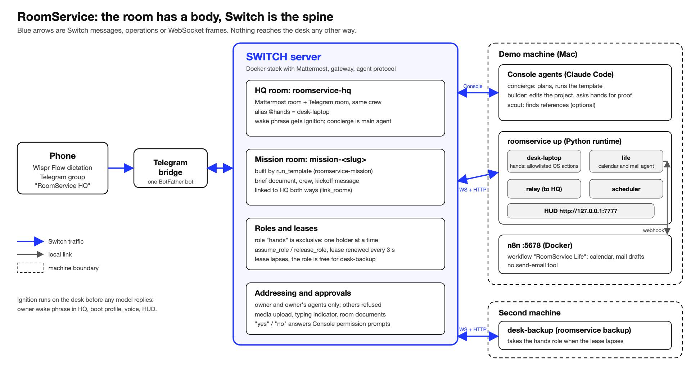

<!-- HUMAN TODO (Yash / Lakshay): add real screenshots where marked [SCREENSHOT], paste the final video link and repo link, then publish on dev.to (RS-16 posts it). Numbers marked (measure) must be filled from a real run or deleted. -->

Every work session for us starts the same way: open the folder, the editor, the dev server, the right tab, the music, the calendar. It takes a while, and our AI helpers live in separate tabs, forget everything and cannot safely touch the machine.

For the Flip the Switch hackathon we asked what if the room itself were a Switch room: an agent with a body, a program on a real computer that opens apps, takes screenshots and closes up for the night, reachable from the phone and obeying only us. We called it RoomService. This is what we learned, written for someone who has never touched Switch.

## Switch in three lines

Switch is open-source infrastructure that puts AI agents into team chat. A server (Docker, with Mattermost bundled) holds rooms, and Switch Console is the desktop app that runs coding agents such as Claude Code and connects chat apps like Telegram. A room is a chat channel plus a shared log, instructions, documents and roles; people and agents are members, and an agent acts only when it is `@mentioned` and the sender is allowed to instruct it.

Our version of the idea fits in one picture.



[SCREENSHOT: Console Home showing the server Running and Mattermost]

## Setup, in the order that matters

1. **Run a server and check it:** `curl $SWITCH_URL/health` should return `200`. Create a registration key in the Gateway.
2. **Register your own agents first** (`uv run roomservice register`). Templates name agents, and Switch refuses a template that names one that does not exist yet.
3. **Import the crew template.** It creates the Planner (`concierge`), Builder, Researcher (`scout`) and the main chat room `roomservice-hq`.
4. **Connect Telegram.** One BotFather bot, Group Privacy off before you add it anywhere. Bots cannot create groups, so you create the group and add the bot.
5. **Pair yourself.** The desk only trusts participant ids it captured during pairing.

[SCREENSHOT: the Telegram group with the team introduced]

## A protocol agent is a WebSocket and a promise to answer pings

The agent protocol is small. You register once with `POST /agents` and a registration key, and get back an id and an API key (shown once). Then you open one WebSocket per room and follow three rules:

- Answer the server's `ping` frame (every 2 seconds) with a `pong` carrying your cursor, immediately. Six seconds of silence and you are evicted.
- Act only on `message` events whose `payload.addressed` is true. Everything else is context.
- Do work through `POST /agents/{id}/ops/{name}`: `post_message`, `assume_role`, `run_template`, and so on.

A sketch of the heart of it, not our production code:

```python
async for raw in ws:
    frame = json.loads(raw)
    if frame.get("type") == "ping":
        await ws.send(json.dumps({"type": "pong", "cursor": cursor}))
        continue
    if frame.get("event") == "message":
        data = frame["data"]
        cursor = frame["id"]
        if data["payload"]["addressed"]:
            await handle(data["room_id"], data["payload"]["body"])
```

Our real client adds reconnect with backoff, a stored cursor and a rule about which refusals are fatal, but the loop above is most of it. Our Computer and our Assistant (`life`) bridge are this loop with different handlers.

## The Computer is a program, not a model

The Computer understands a tiny grammar, one command per line: `boot`, `task`, `open`, `url`, `run`, `shot`, `say`, `close`, `commit`, `push`, `wrap`, `resume` and a few more. It has no shell. Apps, URL patterns and scripts come from an allowlist in `config/desk.yaml`, and commands reach the operating system as argument lists, never through a shell string. `@computer open Steam` answers `⛔ refused · open Steam — not on the allowlist`.

This is the part we trust Switch for. Addressing rules mean someone else in the room is refused before the Computer even sees the message. Approvals (`commit`, `push`, `close all`) resolve only from the participant ids captured at pairing, so an agent cannot approve its own risky step and a display name proves nothing.

## Templates run by agents

When you say "Room service, tonight we ship the Volt waitlist page", two things happen at once. The Computer hears the wake phrase from the paired owner and wakes up: lights, voice, editor, dev server, browser, focus mode. That is plain code and it does not wait for any model. Meanwhile the Planner (`concierge`) reads the same message and calls `run_template` with our task template, which creates `task-volt-waitlist` with the team, a `task-brief` document and a kickoff message that wakes the Computer and the Builder. The template is why every task has the same shape.

[SCREENSHOT: Mattermost task room right after creation]

## Roles and handoff

The `hands` role is exclusive: one holder at a time, and an agent holds one role across all rooms. The Computer takes it when a task starts and renews its lease every 3 seconds. A second machine runs `roomservice backup`, which polls the newest task room and takes the role when it is free. Close the lid, and the HUD on the other laptop flashes COMPUTER TRANSFERRED. We built an explicit fallback (`@computer release` before closing the lid) in case the lease takes too long to lapse; the measured lapse time is in `DECISIONS.md` once spike S8 has been run on the real server (measure).

## Five gotchas we actually hit

These are all recorded in our `DECISIONS.md`, which we kept as we went.

1. **An agent cannot change its own settings.** On Switch server 0.31.0, `update_agent_detail` for an agent's own addressing returns 403 ("An agent can't change its own settings"). Our register command called it anyway and our first spike stopped there. New agents on that version already default to owner and the owner's agents, so the call was unnecessary, and we now treat the failure as a warning.
2. **Docs and your Console version can disagree.** Console 0.40.1 had no "Full admin interface" button, and the Gateway was the only documented place to create a registration key. So we ran the self-hosted Docker Compose stack and pointed Console at it ("Connect to an existing server") instead of using Console's built-in local server.
3. **The server only listens on loopback.** A second machine cannot reach `127.0.0.1`. Either bind the server to a LAN address or use an SSH port forward (`ssh -N -L port:127.0.0.1:port user@host`), which always works.
4. **Resume can replay events.** The cursor advances after the handler finishes, so a reconnect could re-enqueue an event that was still in flight. We now skip frames at or below the highest id we already queued.
5. **A URL rule that allows `&` is not safe on Windows.** Our `url` verb correctly allows query strings, but `cmd /c start` treats `&` as a command separator, so `https://x.com&calc` would have run `calc`. We switched to `rundll32 url.dll,FileProtocolHandler`. The same review found that PowerShell treats typographic quotes as string delimiters, so our `say` escaping only doubled the ASCII one.
Two honest caveats: the builder's permission prompts are detected by a literal phrase match until we capture a real fixture, and our n8n workflow JSON was written by hand, so re-pick its credentials after importing.

## What we would do next

Let the room follow you between machines, let a friend's computer join your task room, and keep a store of task templates. Remove Switch from this project and the room has no body, no memory and no leash.

## Links

- Repo: https://github.com/InnoShay/switchers
- Demo video: VIDEO_URL_PLACEHOLDER
- #HowISwitch

This post was dictated with Wispr Flow.
